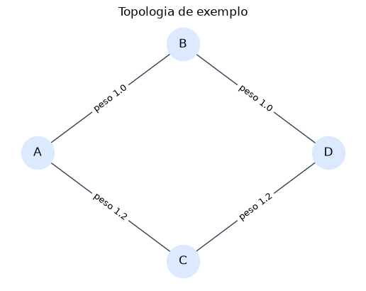
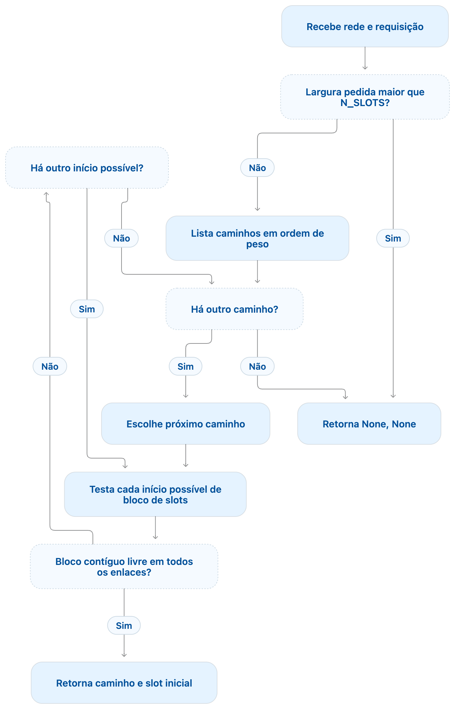
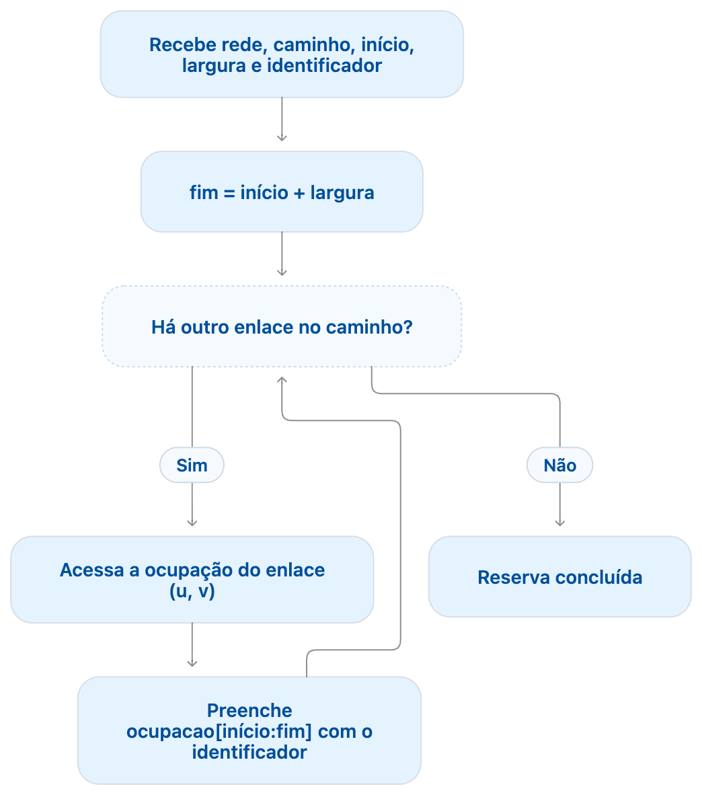
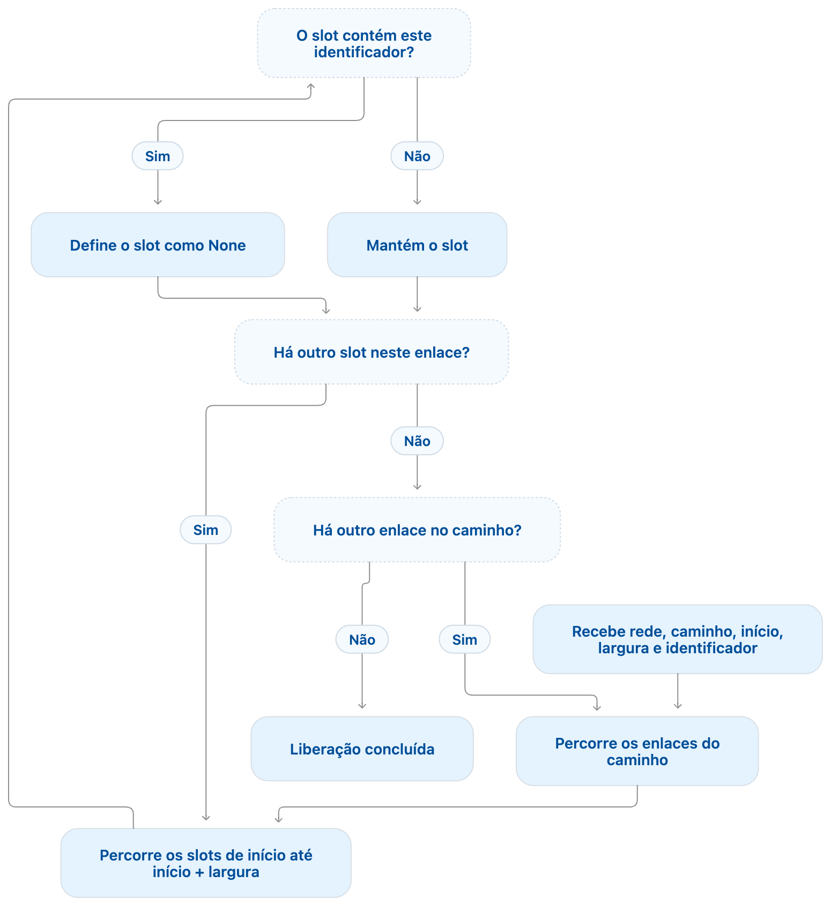
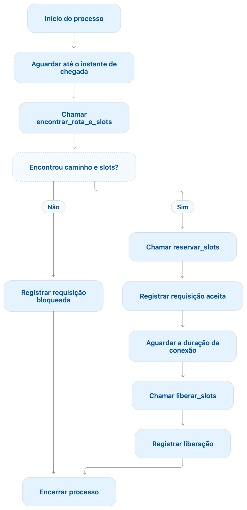
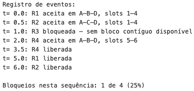
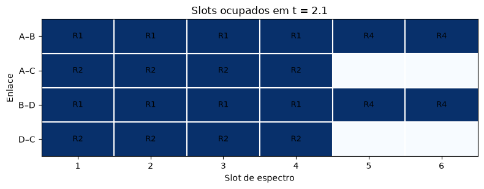

# Simulação EON com NetworkX e SimPy

Exemplo didático de uma rede óptica elástica (EON) com roteamento, alocação e liberação de slots. O notebook combina **NetworkX** para representar a topologia, **SimPy** para avançar o tempo e **Matplotlib** para visualizar a rede e seus recursos.

## Cenário

A topologia em losango oferece dois caminhos entre A e D. Cada enlace tem seis slots. Os pesos são custos abstratos usados para ordenar os caminhos, não representando comprimentos físicos.

<p align="center">
  
</p>

O algoritmo tenta os caminhos em ordem de custo e aplica *first-fit*: escolhe o primeiro bloco contíguo disponível em todos os enlaces da rota. As requisições chegam em tempos diferentes e permanecem ativas por durações definidas no notebook.

| Requisição | Chegada | Slots | Duração |
|---|---:|---:|---:|
| R1 | 0,0 | 4 | 5,0 |
| R2 | 0,5 | 4 | 5,5 |
| R3 | 1,0 | 3 | 2,0 |
| R4 | 2,0 | 2 | 1,5 |

## Etapas do algoritmo

Os diagramas resumem as funções principais implementadas no notebook.

<table>
  <tr>
    <th>Encontrar rota e slots</th>
    <th>Reservar slots</th>
  </tr>
  <tr>
    <td></td>
    <td></td>
  </tr>
  <tr>
    <th>Liberar slots</th>
    <th>Processar requisição</th>
  </tr>
  <tr>
    <td></td>
    <td></td>
  </tr>
</table>

## Saídas do exemplo

O registro mostra quando cada conexão é aceita, bloqueada ou liberada. O mapa representa a ocupação de cada enlace em `t = 2,1`, enquanto há conexões ativas.

<table>
  <tr>
    <th>Registro de eventos</th>
    <th>Ocupação dos slots em t = 2,1</th>
  </tr>
  <tr>
    <td></td>
    <td></td>
  </tr>
</table>

Nesta sequência fixa, três requisições são aceitas e uma é bloqueada. O valor de 25% descreve somente este exemplo; não é uma estimativa estatística de desempenho.

## Executar

Crie e ative uma virtualenv com Python na raiz do projeto, instale as dependências e abra o notebook:

```bash
python3 -m venv .venv
source .venv/bin/activate
python -m pip install --upgrade pip
python -m pip install jupyter networkx simpy matplotlib
jupyter notebook eon_network_simpy.ipynb
```

Depois, execute as células do notebook em ordem. A pasta `.venv/` é local e já está ignorada pelo Git.

## Escopo

O exemplo foca no fluxo de eventos e na continuidade de slots.  Próximos passos poderiam focar em:

* Modelagem da camada física;
* Adição de bandas de guarda;
* Modelagem de efeitos de propagação;
* etc.
